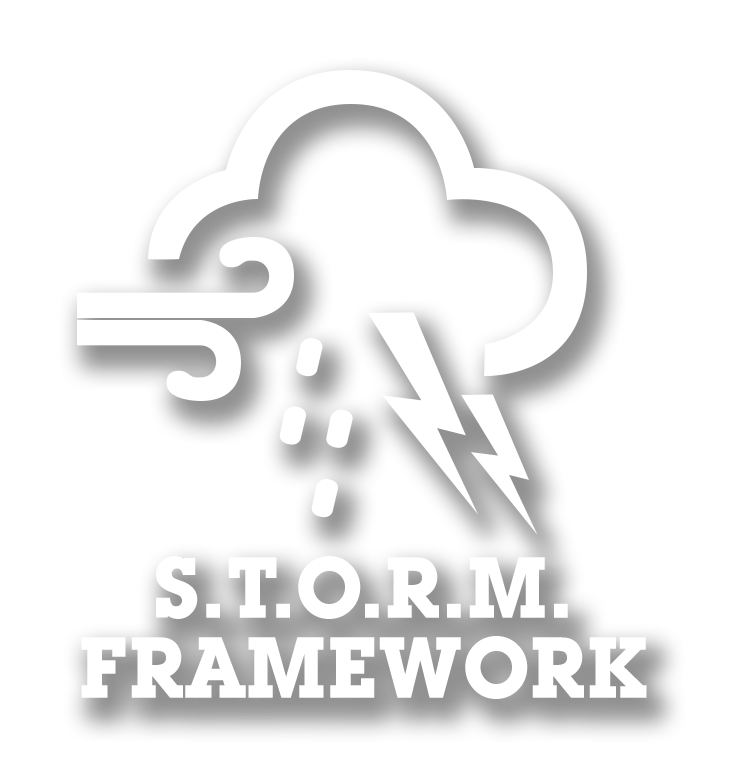

# STORM Framework

Dynamic, immersive weather events for Arma 3: sandstorms, snowstorms and more, with weather, fog, wind, particles, sound, post-processing and AI skill handled together, JIP and dedicated server compatible.

> [!WARNING]
> **Being rebuilt from scratch.** This branch is the new foundation and does not contain any functionality yet.
> The previous codebase is archived in the [`v0.5.0.8.broken`](https://github.com/CVO-Org/STORM-Framework/tree/v0.5.0.8.broken) branch. The last working release is [`v0.5.0.8.beta`](https://github.com/CVO-Org/STORM-Framework/releases/tag/v0.5.0.8.beta).

## Dependencies
- [CBA_A3](https://steamcommunity.com/workshop/filedetails/?id=450814997)
- [ACE3](https://steamcommunity.com/workshop/filedetails/?id=463939057)

## License
[Arma Public License No Derivatives (APL-ND)](LICENSE)
